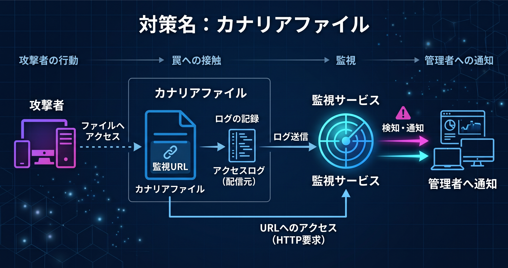
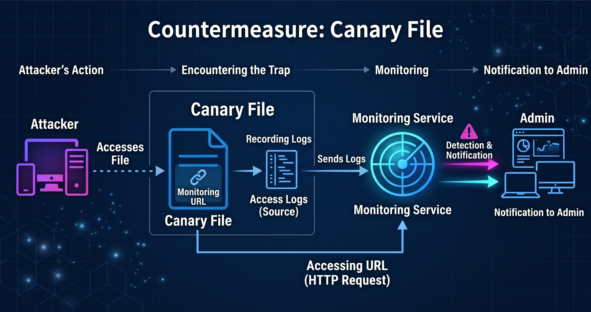

# カナリアファイル / Canary File

[日本語](#日本語) | [English](#english) | [対策一覧 / Measures](../../.github/README.md#security-measures-and-対策一覧)

## 日本語

**提供状況：サンプル生成**

### 仕組みと想定する脅威

業務文書や設定ファイルに監視用URLを埋め込み、持ち出した相手が接続先を試す場面を想定します。業務に合う名前や項目は、候補として調べられる可能性を高めます。

### 運用と限界

ファイルの閲覧・取得だけでは通知されません。URLへの要求を受ける監視先と通知を別途設定し、取得ログと区別します。通信遮断、URLを試さない行動、プレビューによる誤接触に注意してください。

効果は設計上の仮説です。攻撃者がデコイを見抜く、無視する、別経路で本物に到達する場合もあり、検知や遅延は保証されません。[配置・検知・対応](../deployment_ja.md)と[評価方法](../deception_evaluation.md)を参照してください。

## English

**Availability: Sample generation**

### How it works and the threat considered

Place an operator-supplied monitoring URL in a plausible document or configuration file. Contextual names and fields may encourage an intruder to inspect the candidate and try the URL.

### Operation and limitations

Reading or downloading alone does not send an alert. Configure a reachable monitoring endpoint and notifications separately, and distinguish URL contacts from file-access logs. Blocking, skipped URLs and preview scanners affect results.

The effect is a design hypothesis. An intruder can identify or ignore decoys or reach the real target by another route; neither detection nor delay is guaranteed. See [deployment and response](../deployment_en.md) and [evaluation](../deception_evaluation.md).
