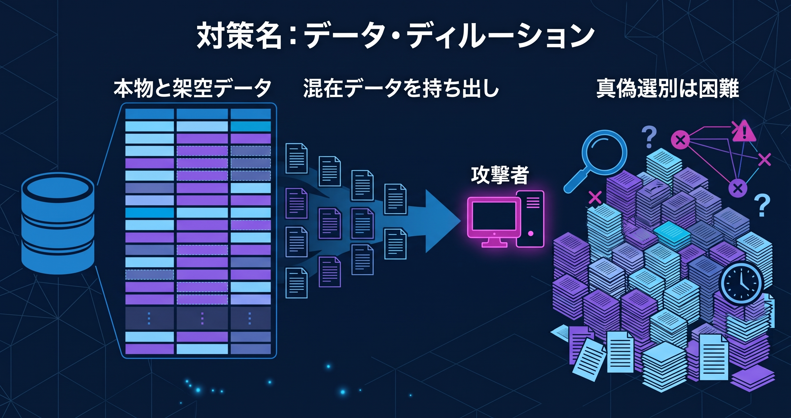
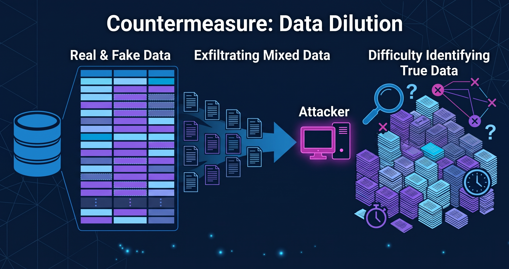

# データ・ディルーション / Data Dilution

[日本語](#日本語) | [English](#english) | [対策一覧 / Measures](../../.github/README.md#security-measures-and-対策一覧)

## 日本語

**提供状況：技術紹介のみ・生成機能なし**

### 仕組みと想定する脅威

本物に多数の合成レコードを混ぜ、流出後に個々の候補を選別する作業を増やす構想です。正規業務が本物を判別できる仕組みも必要です。

### 運用と限界

本アプリは本物との混合や生成を実装しません。全件公開、外部照合、判別機構の侵害では効果が弱まり、本物の流出自体は防げません。誤送信や正規業務への影響を評価します。

効果は設計上の仮説です。攻撃者がデコイを見抜く、無視する、別経路で本物に到達する場合もあり、検知や遅延は保証されません。[配置・検知・対応](../deployment_ja.md)と[評価方法](../deception_evaluation.md)を参照してください。

## English

**Availability: Concept only; no generator**

### How it works and the threat considered

A proposed technique mixes synthetic records with genuine data to make individual records harder to classify after a leak. Authorized workflows need a protected way to distinguish genuine records.

### Operation and limitations

The app does not implement mixing or generation. Publishing everything, external correlation or compromise of the discriminator reduces the benefit; genuine data still leaks. Assess operational errors and accidental messages.

The effect is a design hypothesis. An intruder can identify or ignore decoys or reach the real target by another route; neither detection nor delay is guaranteed. See [deployment and response](../deployment_en.md) and [evaluation](../deception_evaluation.md).
