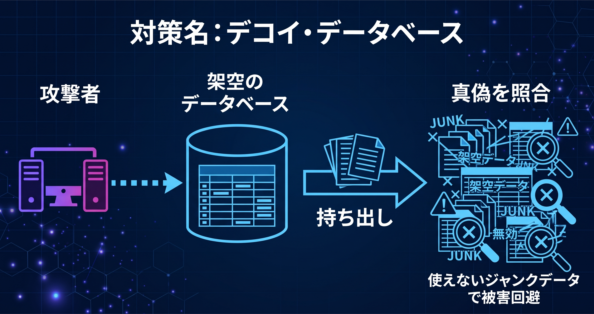
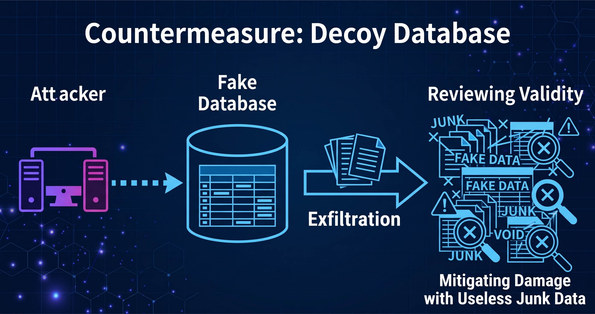

# デコイ・データベース / Decoy Database

[日本語](#日本語) | [English](#english) | [対策一覧 / Measures](../../.github/README.md#security-measures-and-対策一覧)

## 日本語

**提供状況：サンプル生成**

### 仕組みと想定する脅威

架空のB2C顧客データを含む単一テーブルのSQLiteを作ります。顧客情報を探す相手が回収した候補を比較・検証する作業を想定します。

### 運用と限界

生成DBはカナリアを含まず、本番DBには接続しません。閲覧や持ち出しの検知には別途ファイル監査が必要です。一括取得や本物の別経路からの取得は防げません。

効果は設計上の仮説です。攻撃者がデコイを見抜く、無視する、別経路で本物に到達する場合もあり、検知や遅延は保証されません。[配置・検知・対応](../deployment_ja.md)と[評価方法](../deception_evaluation.md)を参照してください。

## English

**Availability: Sample generation**

### How it works and the threat considered

Creates a standalone SQLite file containing one table of fictional B2C customer records. It is intended as a candidate for someone collecting and validating customer data.

### Operation and limitations

The database contains no canary and does not connect to production. File auditing is needed to detect access or collection. Bulk collection and finding the real data elsewhere remain possible.

The effect is a design hypothesis. An intruder can identify or ignore decoys or reach the real target by another route; neither detection nor delay is guaranteed. See [deployment and response](../deployment_en.md) and [evaluation](../deception_evaluation.md).
