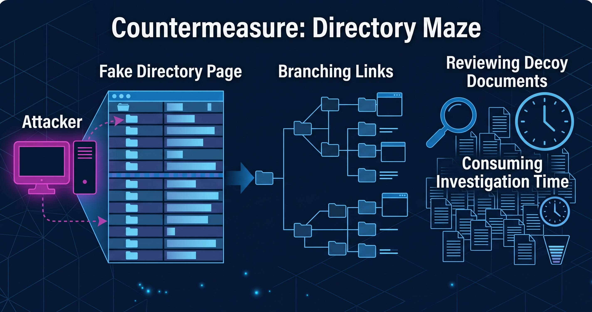

# ディレクトリ・メイズ / Directory Maze

[日本語](#日本語) | [English](#english) | [対策一覧 / Measures](../../.github/README.md#security-measures-and-対策一覧)

## 日本語

**提供状況：開発中・初版では利用不可**

### 仕組みと想定する脅威

有限の実ディレクトリとHTMLリンクの分岐に架空文書を置き、クローラーや生成スクリプトが候補を収集・確認する作業を増やす構想です。

### 運用と限界

初版の画面・APIでは選択・生成できません。URLの重複排除や並列化で探索は速くなります。配信ログと、URLが試された場合のカナリア通知を区別し、対応表は運用者専用にします。

効果は設計上の仮説です。攻撃者がデコイを見抜く、無視する、別経路で本物に到達する場合もあり、検知や遅延は保証されません。[配置・検知・対応](../deployment_ja.md)と[評価方法](../deception_evaluation.md)を参照してください。

## English

**Availability: In development; unavailable in initial release**

### How it works and the threat considered

A proposed finite tree of real directories, HTML links and synthetic documents creates candidates for crawlers and generated scripts to collect and inspect.

### Operation and limitations

Unavailable through the initial-release UI and API. URL deduplication and parallelism speed exploration. Distinguish serving logs from canary URL contacts, and keep mappings operator-only.

The effect is a design hypothesis. An intruder can identify or ignore decoys or reach the real target by another route; neither detection nor delay is guaranteed. See [deployment and response](../deployment_en.md) and [evaluation](../deception_evaluation.md).
