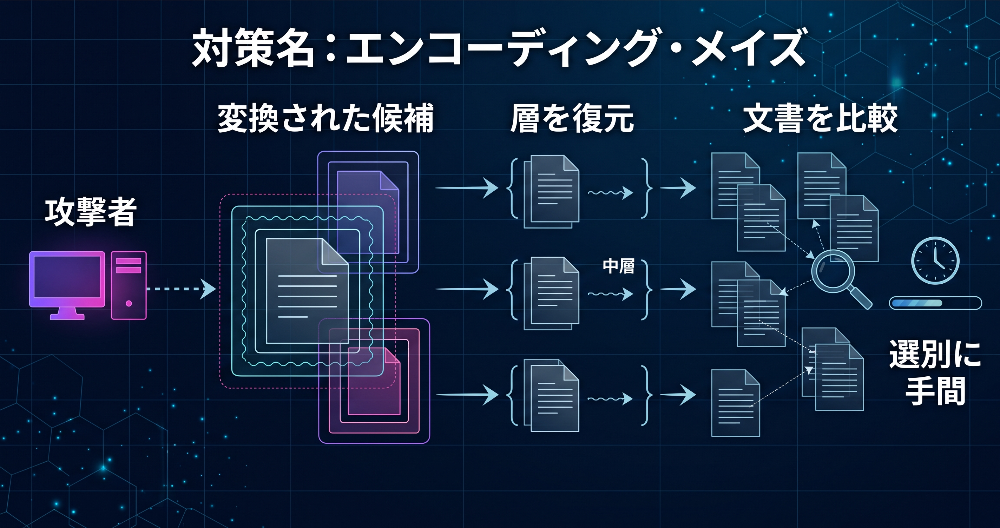
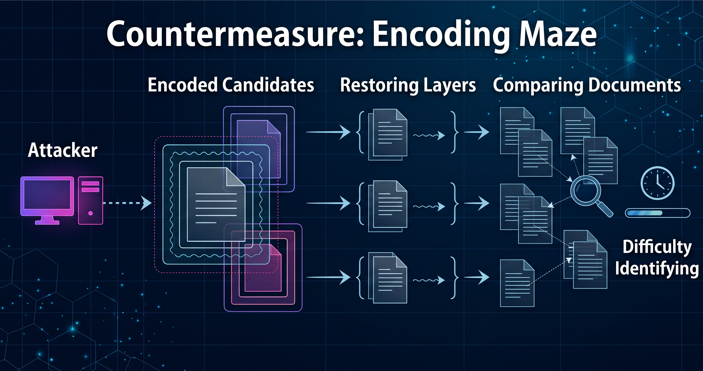

# エンコーディング・メイズ / Encoding Maze

[日本語](#日本語) | [English](#english) | [対策一覧 / Measures](../../.github/README.md#security-measures-and-対策一覧)

## 日本語

**提供状況：開発中・初版では利用不可**

### 仕組みと想定する脅威

業務シナリオに沿う複数の架空候補を多段エンコードし、取得後の復元と選別に追加作業が生じる可能性を評価する構想です。

### 運用と限界

初版の画面・APIでは選択・生成できません。エンコードは暗号化ではなく、一括復元や並列解析が可能です。オフラインの閲覧は通知されず、取得監視と運用者専用の対応表が別途必要です。

効果は設計上の仮説です。攻撃者がデコイを見抜く、無視する、別経路で本物に到達する場合もあり、検知や遅延は保証されません。[配置・検知・対応](../deployment_ja.md)と[評価方法](../deception_evaluation.md)を参照してください。

## English

**Availability: In development; unavailable in initial release**

### How it works and the threat considered

A proposed set of independently generated synthetic candidates uses multiple encoding layers to explore whether restoration and selection add work after collection.

### Operation and limitations

Unavailable through the initial-release UI and API. Encoding is not encryption; batch decoding and parallel analysis are possible. Offline reading does not alert. Separate access monitoring and an operator-only mapping are needed.

The effect is a design hypothesis. An intruder can identify or ignore decoys or reach the real target by another route; neither detection nor delay is guaranteed. See [deployment and response](../deployment_en.md) and [evaluation](../deception_evaluation.md).
