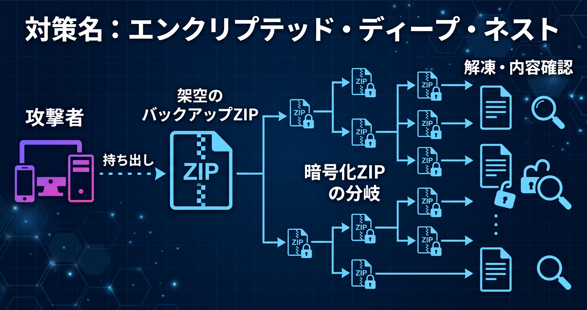
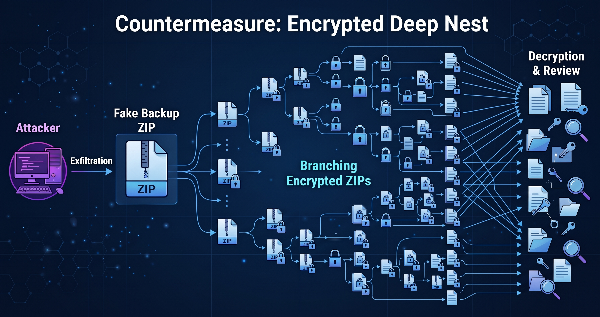

# エンクリプテッド・ディープ・ネスト / Encrypted Deep Nest

[日本語](#日本語) | [English](#english) | [対策一覧 / Measures](../../.github/README.md#security-measures-and-対策一覧)

## 日本語

**提供状況：サンプル生成**

### 仕組みと想定する脅威

AES暗号化されたZIPの中に、架空文書と分岐した別のZIPを配置します。バックアップなどに見える候補を調べ、展開する際の選別作業を増やす構想です。

### 運用と限界

検証用パスワード一覧は配置物と分けて保管します。取得後の並列・オフライン解析では現場の遅延は小さく、パスワードもオフラインで試行され得ます。開封自体の通知はなく、暗号化やバックアップの代替ではありません。

効果は設計上の仮説です。攻撃者がデコイを見抜く、無視する、別経路で本物に到達する場合もあり、検知や遅延は保証されません。[配置・検知・対応](../deployment_ja.md)と[評価方法](../deception_evaluation.md)を参照してください。

## English

**Availability: Sample generation**

### How it works and the threat considered

An AES-encrypted ZIP contains synthetic documents and branching nested archives. Backup-like candidates may require extra selection and extraction work.

### Operation and limitations

Keep the verification password list separate from deployed files. Parallel or offline analysis after collection reduces on-site delay, and passwords can be attacked offline. Opening an archive does not alert; this is no substitute for encryption or backups.

The effect is a design hypothesis. An intruder can identify or ignore decoys or reach the real target by another route; neither detection nor delay is guaranteed. See [deployment and response](../deployment_en.md) and [evaluation](../deception_evaluation.md).
