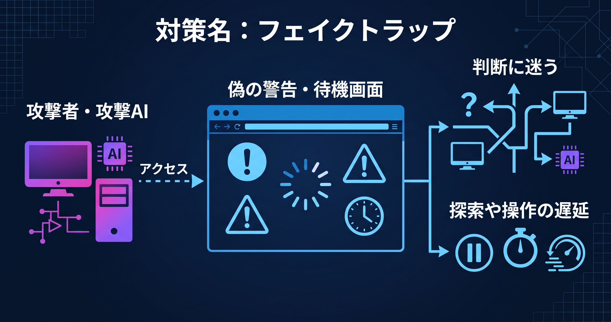
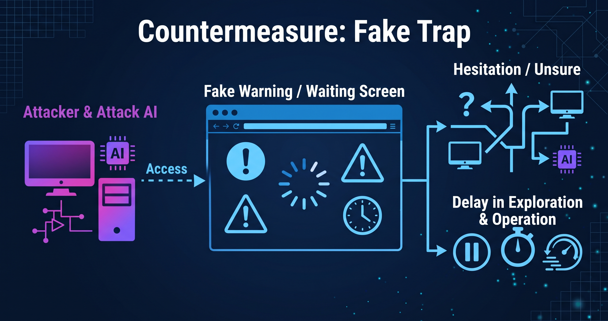

# フェイクトラップ / Fake Trap

[日本語](#日本語) | [English](#english) | [対策一覧 / Measures](../../.github/README.md#security-measures-and-対策一覧)

## 日本語

**提供状況：サンプル生成**

### 仕組みと想定する脅威

サインイン確認やメンテナンスなどの業務画面風HTMLを作ります。画面の状態を読む人やAIが状況を再確認する場合、追加の判断が生じる可能性があります。

### 運用と限界

監視を有効にしてURLを入力すると、表示時に埋め込み画像がGET要求を送ります。プレビューも接触し得ます。表示を無視する相手、画面を読まないスクリプト、並列探索への効果は限られ、ログと通知は別途必要です。

効果は設計上の仮説です。攻撃者がデコイを見抜く、無視する、別経路で本物に到達する場合もあり、検知や遅延は保証されません。[配置・検知・対応](../deployment_ja.md)と[評価方法](../deception_evaluation.md)を参照してください。

## English

**Availability: Sample generation**

### How it works and the threat considered

Creates business-style HTML such as sign-in review or maintenance pages. A person or AI agent interpreting the display may spend time reassessing it.

### Operation and limitations

With monitoring enabled and a URL supplied, an embedded image sends a GET on page load; previews may also trigger it. Scripts that ignore the display and parallel exploration reduce the effect. Configure logs and alerts separately.

The effect is a design hypothesis. An intruder can identify or ignore decoys or reach the real target by another route; neither detection nor delay is guaranteed. See [deployment and response](../deployment_en.md) and [evaluation](../deception_evaluation.md).
