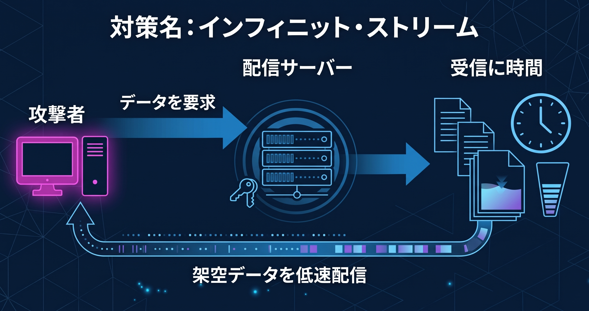
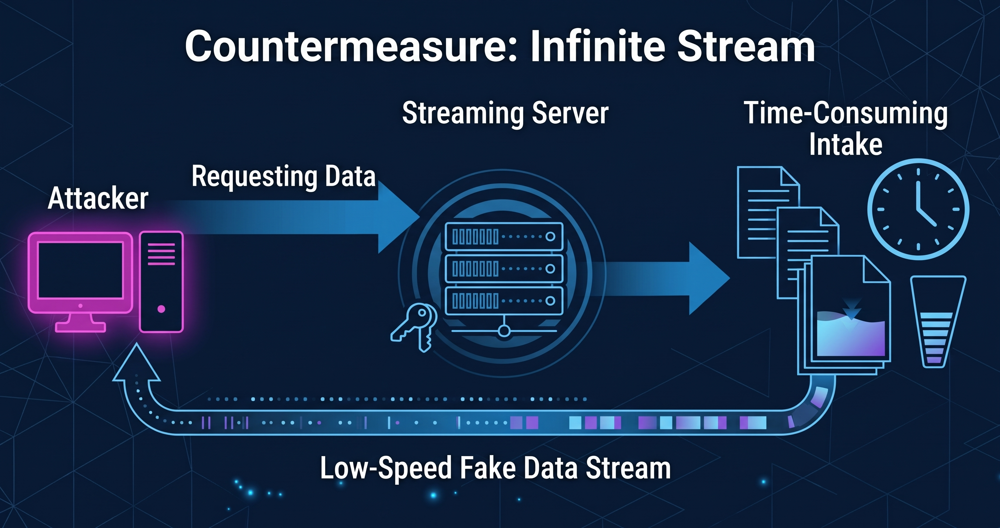

# インフィニット・ストリーム / Infinite Stream

[日本語](#日本語) | [English](#english) | [対策一覧 / Measures](../../.github/README.md#security-measures-and-対策一覧)

## 日本語

**提供状況：開発中・初版では利用不可**

### 仕組みと想定する脅威

認証付きの隔離経路で接続中に終端のないデータを返し、全量の取得完了を待つ相手の時間を使わせる構想です。帯域と同時接続の制限、停止手順を設けます。

### 運用と限界

初版の画面・APIでは選択・生成できません。部分取得、切断、並列探索で回避され、応答自体が不審に見える場合もあります。配信側で開始イベント、容量、負荷と停止を管理する必要があります。

効果は設計上の仮説です。攻撃者がデコイを見抜く、無視する、別経路で本物に到達する場合もあり、検知や遅延は保証されません。[配置・検知・対応](../deployment_ja.md)と[評価方法](../deception_evaluation.md)を参照してください。

## English

**Availability: In development; unavailable in initial release**

### How it works and the threat considered

A proposed authenticated isolated endpoint sends data without a total size or duration cutoff while connected, potentially occupying a client that waits for a complete download. Rate, concurrency and operator stop need controls.

### Operation and limitations

Unavailable through the initial-release UI and API. Partial downloads, disconnects and parallel exploration bypass the wait; the response may look suspicious. The host must manage start events, capacity, load and shutdown.

The effect is a design hypothesis. An intruder can identify or ignore decoys or reach the real target by another route; neither detection nor delay is guaranteed. See [deployment and response](../deployment_en.md) and [evaluation](../deception_evaluation.md).
