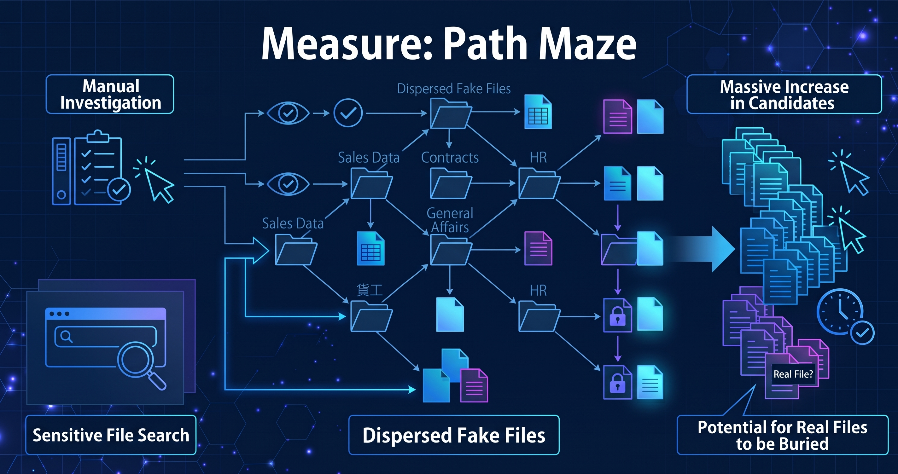

# パス・メイズ / Path Maze

[日本語](#日本語) | [English](#english) | [対策一覧 / Measures](../../.github/README.md#security-measures-and-対策一覧)

## 日本語

**提供状況：サンプル生成**

### 仕組みと想定する脅威

OSに合わせた名前の有限フォルダーと架空ファイルを分散配置し、手作業や検索結果に含まれる候補の選別を増やす構想です。

### 運用と限界

自動分類、除外、一括取得、並列探索で効果は弱まります。配置・撤去用の一覧は運用者専用として分離し、ファイル取得を知るには別途監査が必要です。

効果は設計上の仮説です。攻撃者がデコイを見抜く、無視する、別経路で本物に到達する場合もあり、検知や遅延は保証されません。[配置・検知・対応](../deployment_ja.md)と[評価方法](../deception_evaluation.md)を参照してください。

## English

**Availability: Sample generation**

### How it works and the threat considered

Creates a finite tree of synthetic files with an OS-specific naming profile. It may increase selection work when manual investigation or search tools include decoys as candidates.

### Operation and limitations

Automatic classification, exclusions, bulk collection and parallel exploration can reduce the effect. Keep the placement inventory operator-only; separate auditing is needed to observe file access.

The effect is a design hypothesis. An intruder can identify or ignore decoys or reach the real target by another route; neither detection nor delay is guaranteed. See [deployment and response](../deployment_en.md) and [evaluation](../deception_evaluation.md).
