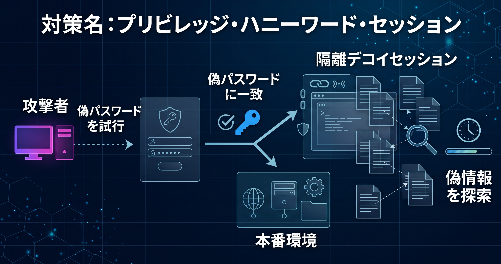
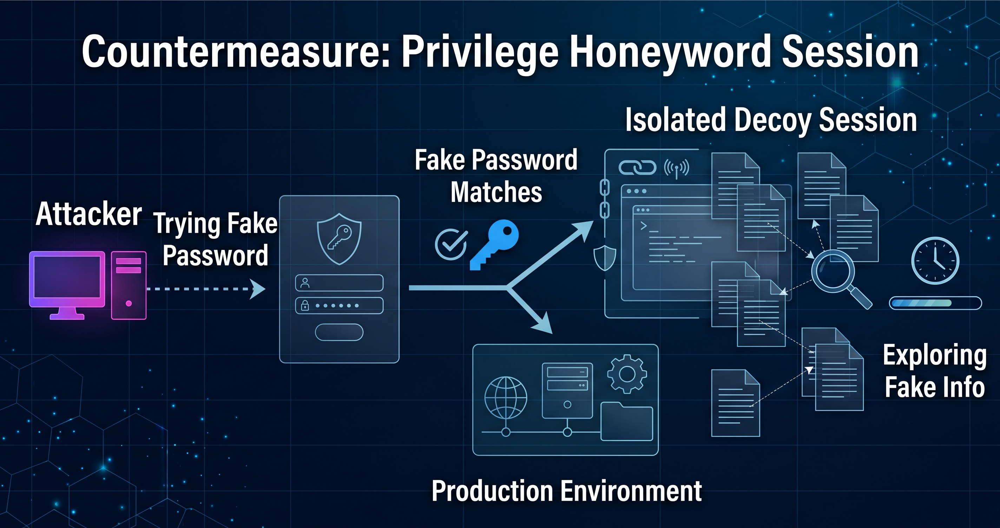

# 特権ハニーワード・セッション / Privilege Honeyword Session

[日本語](#日本語) | [English](#english) | [対策一覧 / Measures](../../.github/README.md#security-measures-and-対策一覧)

## 日本語

**提供状況：技術紹介のみ・認証連携なし**

### 仕組みと想定する脅威

認証側に偽パスワードを登録し、一致した試行を本番認証と分離した偽セッションに誘導する構想です。偽環境を調べる場合、検知と追加作業につながる可能性があります。

### 運用と限界

本アプリに認証連携はありません。登録した偽候補に一致しなければ誘導されず、誤入力やMFAの差も考慮が必要です。本番認証、試行制限、偽環境の分離を維持します。

効果は設計上の仮説です。攻撃者がデコイを見抜く、無視する、別経路で本物に到達する場合もあり、検知や遅延は保証されません。[配置・検知・対応](../deployment_ja.md)と[評価方法](../deception_evaluation.md)を参照してください。

## English

**Availability: Concept only; no authentication integration**

### How it works and the threat considered

A proposed authentication system registers decoy passwords and routes a matching attempt to a fake session isolated from production. Investigating that session may create detection and delay opportunities.

### Operation and limitations

The app has no authentication integration. Attempts that do not match a registered decoy are not redirected; legitimate mistakes and MFA differences need evaluation. Preserve production authentication, rate limits and isolation.

The effect is a design hypothesis. An intruder can identify or ignore decoys or reach the real target by another route; neither detection nor delay is guaranteed. See [deployment and response](../deployment_en.md) and [evaluation](../deception_evaluation.md).
