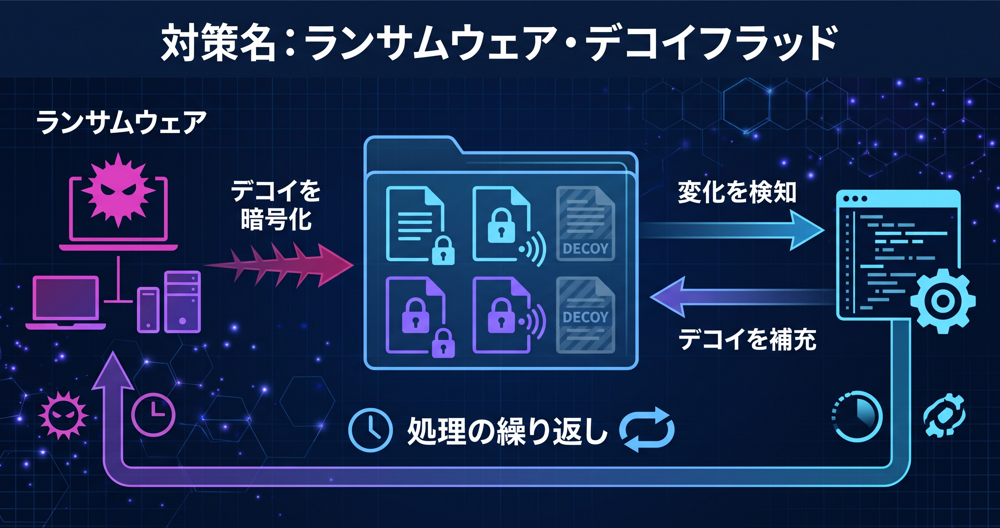
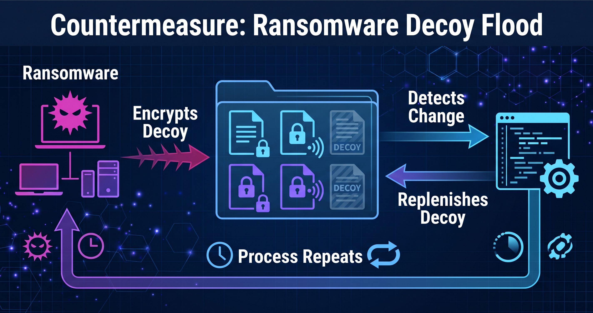

# ランサムウェア・デコイフラッド / Ransomware Decoy Flood

[日本語](#日本語) | [English](#english) | [対策一覧 / Measures](../../.github/README.md#security-measures-and-対策一覧)

## 日本語

**提供状況：開発中・初版では利用不可**

### 仕組みと想定する脅威

架空の業務ファイルと、それらの変更・削除・差し替えをローカル記録する監視の構想です。監視対象に触れる攻撃の手掛かりを得ることを狙います。

### 運用と限界

初版の画面・APIでは選択・生成できません。設計上の監視は約1秒間隔で、読み取りは検知せず見逃しや誤検知もあります。実データの破壊が先行し得て、暗号化の停止や復元は行いません。

効果は設計上の仮説です。攻撃者がデコイを見抜く、無視する、別経路で本物に到達する場合もあり、検知や遅延は保証されません。[配置・検知・対応](../deployment_ja.md)と[評価方法](../deception_evaluation.md)を参照してください。

## English

**Availability: In development; unavailable in initial release**

### How it works and the threat considered

A proposed set of fictional business files and a local monitor records changes, deletions or replacement of selected files as possible signs of destructive activity.

### Operation and limitations

Unavailable through the initial-release UI and API. The proposed monitor polls about once a second, does not detect reads and can miss events or produce false positives. Real data may be damaged first; it does not stop encryption or restore files.

The effect is a design hypothesis. An intruder can identify or ignore decoys or reach the real target by another route; neither detection nor delay is guaranteed. See [deployment and response](../deployment_en.md) and [evaluation](../deception_evaluation.md).
