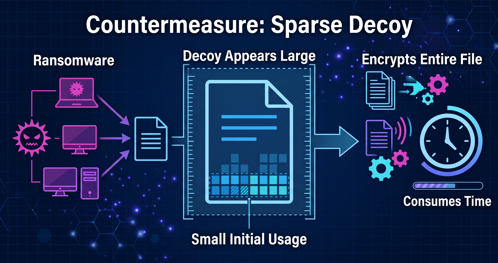

# スパース・デコイ / Sparse Decoy

[日本語](#日本語) | [English](#english) | [対策一覧 / Measures](../../.github/README.md#security-measures-and-対策一覧)

## 日本語

**提供状況：サンプル生成**

### 仕組みと想定する脅威

初期割り当てが小さく、見かけのサイズが大きい架空ファイルを作ります。空き領域を認識せず全体を処理する場合に、追加の作業が生じる可能性があります。

### 運用と限界

部分取得やサイズによる除外では効果が弱まります。コピーや書き込みで論理サイズ分の容量を消費し得るため、空き容量を監視します。ランサムウェアを停止せず、拡張子と内容形式は一致しません。

効果は設計上の仮説です。攻撃者がデコイを見抜く、無視する、別経路で本物に到達する場合もあり、検知や遅延は保証されません。[配置・検知・対応](../deployment_ja.md)と[評価方法](../deception_evaluation.md)を参照してください。

## English

**Availability: Sample generation**

### How it works and the threat considered

Creates a synthetic file with a large logical size and small initial allocation. Processing the whole file without recognizing sparse regions may require extra work.

### Operation and limitations

Partial processing and size exclusions reduce the effect. Copies or writes can consume the logical size, so monitor capacity. It does not stop ransomware; its extension is cosmetic.

The effect is a design hypothesis. An intruder can identify or ignore decoys or reach the real target by another route; neither detection nor delay is guaranteed. See [deployment and response](../deployment_en.md) and [evaluation](../deception_evaluation.md).
