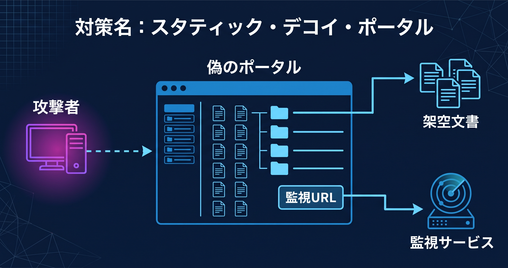
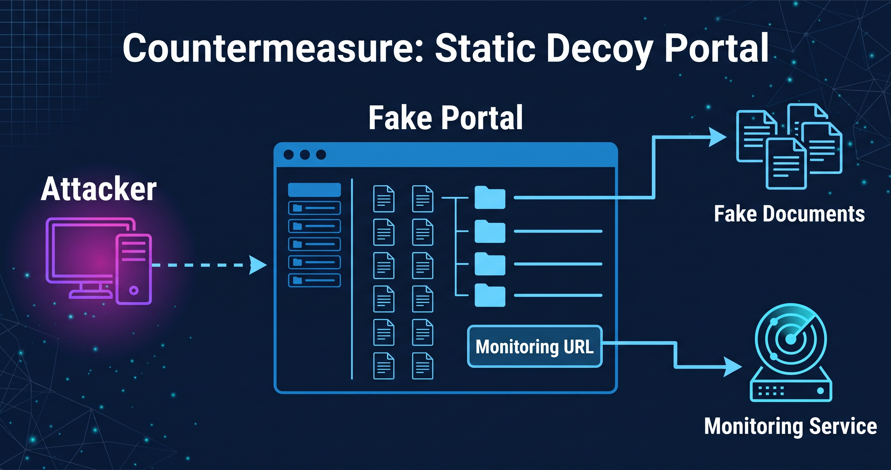

# スタティック・デコイ・ポータル / Static Decoy Portal

[日本語](#日本語) | [English](#english) | [対策一覧 / Measures](../../.github/README.md#security-measures-and-対策一覧)

## 日本語

**提供状況：サンプル生成**

### 仕組みと想定する脅威

アーカイブや管理画面に見える静的HTMLを用意し、管理用URLやファイルを探す相手の候補を増やします。

### 運用と限界

認証、セッション、アクセス制御や通知は実装しません。ページを開くだけではリンク先のカナリアURLにアクセスしません。ページ要求のログとURLへの接触通知は別々に構成します。

効果は設計上の仮説です。攻撃者がデコイを見抜く、無視する、別経路で本物に到達する場合もあり、検知や遅延は保証されません。[配置・検知・対応](../deployment_ja.md)と[評価方法](../deception_evaluation.md)を参照してください。

## English

**Availability: Sample generation**

### How it works and the threat considered

A static HTML page resembles an archive or operations portal, providing another candidate for someone searching for administrative URLs and files.

### Operation and limitations

It implements no authentication, session, access control or notifications. Opening the page does not request the linked canary URL. Configure page-access logs and URL-contact notifications separately.

The effect is a design hypothesis. An intruder can identify or ignore decoys or reach the real target by another route; neither detection nor delay is guaranteed. See [deployment and response](../deployment_en.md) and [evaluation](../deception_evaluation.md).
